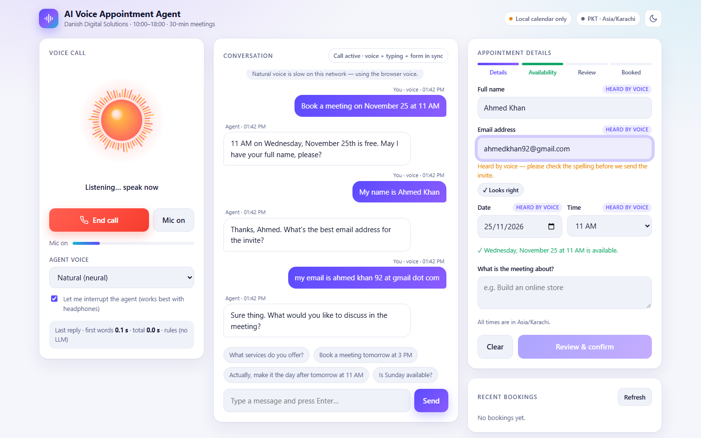
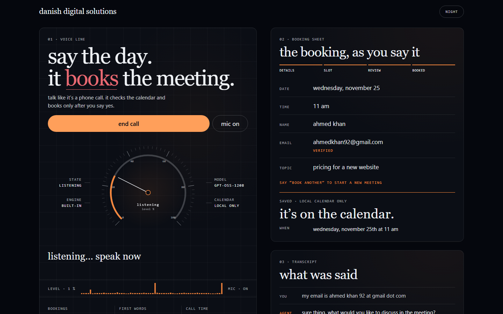
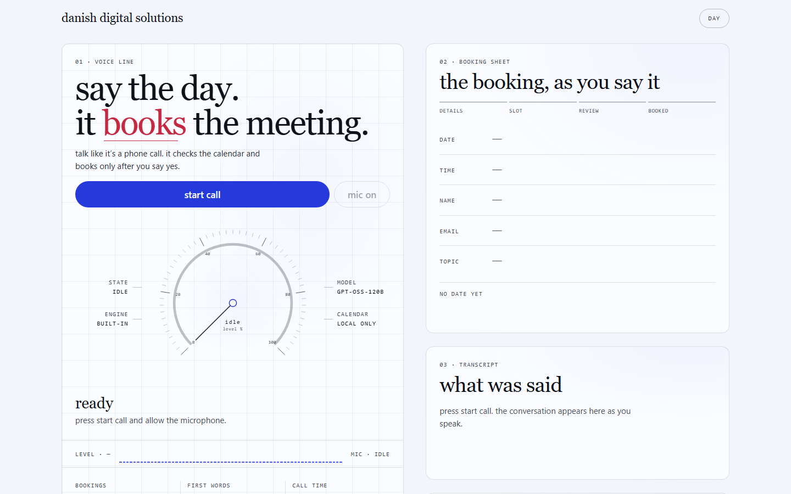
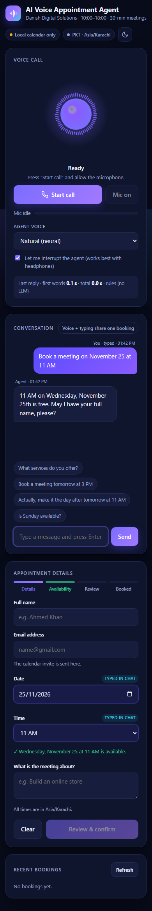

# AI Voice Appointment Agent

A **voice-call** receptionist that books real meetings in **Google Calendar**. Built on free tiers only ($0):
Groq / Gemini free LLMs, the browser's speech APIs, free Microsoft neural voices (edge-tts), Google Calendar API, SQLite.



## What it does

- **Voice only on the page.** You talk; there is no text box and no form to type into. A **read-only booking sheet** fills
  in live as the agent hears you (date, time, name, email, topic), with a progress track, the availability result, and a
  cue for what to say next ("say yes to book it"). Everything lives in **one shared booking state** on the server; the
  same state is also reachable by typed chat and form edits through the API (`/api/web/*`), which the test-suite uses.
- **Collects:** full name, email, date, time, purpose. Understands "tomorrow at 5 PM... actually the day after tomorrow at
  11", "the 20th", "next Monday", "make it 4", "Sunday?" (closed), "10 PM?" (outside hours) and offers real alternatives.
- **Email accuracy:** spoken emails ("ahmed khan 92 at gmail dot com", "double two", "underscore", "at the rate") are parsed
  in code, validated, and **never guessed**: an uncertain email (odd domain, typo like `gmial.com`) is read back
  ("I heard ... Is that correct?" / "Did you mean ...gmail.com?") before use; you confirm it by voice and the sheet marks it verified.
- **Safe booking:** name + email + date + time + purpose validated **server-side** (past dates, closed days, >60 days,
  outside hours, busy slots, time zone), live Google Calendar free/busy check, a read-back summary, an explicit "yes"
  (or the confirm API for exactly the summary shown), then the real event is created. **Success is shown only
  after Google confirms.** Booking is idempotent (deterministic event id, unique slot) so a double click or retry cannot
  create a second event, and a failed calendar call never leaves a half-booking behind.
- **Confirmation email.** After the booking is confirmed by Google, the caller gets an email (details + an "add to Google
  Calendar" link + an `.ics` file) via any SMTP account (`SMTP_*` in `.env`; free with a Gmail App Password). The agent says
  it emailed you only if the mail server accepted it; a mail failure never undoes a booking. No SMTP settings = no email.
- **Call history.** Every conversation (who said what, how it ended: booked / no booking / transferred) is saved as a text
  transcript in SQLite (`app/callog.py`); the **history** button lists this browser's own calls and shows the full
  conversation. No audio is stored, and a visitor can only fetch the call ids their own browser created.
- **Human handoff** ("let me talk to a person" -> instant transfer to `HUMAN_PHONE`), knowledge-base answers from `knowledge/`,
  Twilio phone webhooks for a real phone number.

| Night (default) | Booked | Day drop | Phone |
|---|---|---|---|
|  |  |  |  |

**Design system** (built with the Hallmark skill): *Lumen*, atmospheric genre, Workbench layout. A hand-built SVG voice dial (needle + arc follow the measured microphone level, callouts show live values only), lowercase Instrument Serif headline with one accent verb, mono UPPERCASE labels, blueprint grid, hairline cards that glow from within. Night Foundry (default) and Day Foundry (light) share one token file, `static/tokens.css`; nothing on the page inlines a colour or font. No invented numbers: every figure on screen (bookings, first-words time, call time, level) is measured.

## Architecture

```
Browser (Chrome/Edge)                         FastAPI server                        Free services
 ├ mic -> Web Speech API (STT, n-best    ┐     ├ app/agent.py   CallSession          ├ Groq  gpt-oss-120b  (main LLM)
 │        re-ranking for emails)         │     │   ├ rules: dates/times/emails/      ├ Gemini 2.5 Flash    (fallback)
 ├ typed chat ───────────────────────────┼────►│   │   names/purpose/yes-no/handoff  ├ Groq small models   (fallback)
 ├ editable form (name/email/date/time) ─┘     │   ├ LLM: questions + small talk     ├ Google Calendar API (freeBusy+events)
 ├ voice visualizer, transcript, progress      │   └ guard rails before every booking├ edge-tts neural voice (+browser voice)
 └ streams reply sentence by sentence ◄────────┤ app/booking.py  shared BookingState └ SQLite (data/bookings.db)
                                               │ app/calendar_store.py  slots+bookings
 Phone (Twilio) ──► /twilio/* webhooks ────────┘ app/llm.py  streaming + fallback chain
```

**Design rule: the LLM talks, code decides.** Free-tier models are fast but unreliable at calling tools (we measured Groq
models skipping them), so dates, times, emails, names, purpose, yes/no and handoff are also extracted **in code**. The LLM
handles open questions, and a ready-made spoken answer exists for every dead end, so a rate-limited or weak model cannot
cause a wrong booking.

## Latency (measured, not claimed)

Server-side time to the first spoken sentence, live against Groq/Gemini + Google Calendar from a slow home connection:

| Turn | Before | Now |
|---|---|---|
| "book on Nov 23 at 3 PM" (with real availability check) | 1.8 s | **0.4 s** |
| giving name / email / purpose | 2.2-3.7 s | **< 0.05 s** (no LLM) |
| read-back summary | 0.4 s | 0.4 s |
| "yes" -> booking | 1.7 s | speaks in **< 0.05 s** ("One moment while I book that."), confirmation after Google answers (~2 s: Google's `events.insert` alone takes ~1.4 s) |
| open question answered by the LLM | 1.4-2.1 s | 1.1-1.6 s (first-token time of the model is the floor) |

What made it faster: no LLM round trip for data turns, one shared HTTPS connection per provider (warmed at start-up),
shorter prompt, Google token/connection warm-up, a deterministic Google event id, no redundant availability calls.
Honest notes: LLM output **is** streamed sentence by sentence (Groq and Gemini support SSE), but Groq generates a whole short
answer within ~100 ms of the first token, so streaming adds little there; speech recognition (browser) and voice playback are
separate stages and add their own time. The neural voice (edge-tts) is slow on some networks, so the page measures it at
load and falls back to the instant browser voice; Edge's built-in "Natural" voices are the best option.

## Run it

```powershell
python -m venv .venv
.\.venv\Scripts\pip install -r requirements.txt
copy .env.example .env            # fill LLM_API_KEY (Groq, free), GEMINI_API_KEY (optional), GOOGLE_CALENDAR_ID
.\.venv\Scripts\python -m uvicorn app.main:app --port 8000      # open http://localhost:8000 in Chrome or Edge
```

**Google Calendar (free):** create a service account in Google Cloud, enable the Calendar API, save its key as
`service_account.json`, share your calendar with the service account email ("Make changes to events"), put the calendar
id in `.env`. To also email real invites with a Meet link: `python -m scripts.google_login` (needs an OAuth desktop
`client_secret.json`; a service account cannot invite attendees on a personal Gmail calendar).

**Knowledge base:** put `.md`/`.txt` files in `knowledge/`. **Phone:** point a Twilio number's voice webhook at
`https://<your-host>/twilio/voice` (trial accounts can only call verified numbers - the web link is the safe demo).
**Deploy:** the `Dockerfile` works on Hugging Face Spaces / Render; put the `.env` values (and the service-account JSON text
as `GOOGLE_SERVICE_ACCOUNT_JSON`) in the host's secrets. Use Groq/Gemini there (no local models).

## Optional: Vapi voice engine

[Vapi](https://vapi.ai) is a managed voice platform (streaming speech-to-text, LLM, text-to-speech, phone numbers). The page
can use it instead of the built-in free voice; **the booking rules, form and Google Calendar are the same code**: Vapi talks,
and calls this server's tools (`update_booking_details`, `check_available_slots`, `book_appointment`) over a webhook
(`POST /api/vapi/webhook`, protected by `X-Vapi-Secret`). The caller's words come back through Vapi's conversation, so the
same code-side extraction (dates, times, emails, yes/no) and the read-back + explicit "yes" apply.

```powershell
# 1. deploy the app at a public https URL (Vapi must reach it), 2. then:
.\.venv\Scripts\python -m scripts.vapi_setup --server-url https://your-app.example --dry-run   # inspect first
.\.venv\Scripts\python -m scripts.vapi_setup --server-url https://your-app.example             # creates/updates tools + assistant
# 3. set VAPI_PUBLIC_KEY, VAPI_ASSISTANT_ID, VAPI_WEBHOOK_SECRET on the host -> a "Voice engine" selector appears on the page
```

Status: our side is tested with payloads shaped exactly like Vapi's documented `tool-calls` / `conversation-update` messages
and a mocked web SDK (offline + browser suites). It has **not** been run against a live Vapi call yet (that needs the public
URL), and Vapi bills calls against your Vapi credits.

## Tests

```powershell
.\.venv\Scripts\python -m tests.smoke_test      # 32 offline tests (fake LLM + fake Google + design lint), ~10 s
.\.venv\Scripts\pip install -r requirements-dev.txt
.\.venv\Scripts\python -m tests.ui_test         # 14 real-Chrome tests of the voice page + backend (incl. fit-to-screen on 8 window sizes) (screens in tests/screens/)
.\.venv\Scripts\python -m tests.live_e2e_test   # real LLM + REAL Google Calendar: books, verifies, deletes the test event
.\.venv\Scripts\python -m tests.live_chat_test  # real LLM answers (questions, out-of-scope, Sunday, human)
```

Covered: correctly spoken email, mis-recognised email, uncertain domain, manually entered email, voice -> manual
correction, manual -> voice continuation, slow/streamed replies, interruption, changed time ("make it the day after
tomorrow at 11"), past date, closed day, >60 days, outside hours, busy slot with alternatives, successful booking, duplicate
confirm, other caller wanting a taken slot, failed Google call (create + free/busy), stale confirmation key, phone flow.
The browser tests mock the browser's speech APIs (headless Chrome has no microphone); everything else is the real page and
the real backend.

## Known limits

- Speech recognition is the browser's (Chrome/Edge); it is the least reliable link, hence the email read-back and form.
- Free LLM tiers rate-limit; the chain falls back (Groq -> Gemini -> smaller Groq) and code covers the critical steps.
- Interruption needs headphones for best results (otherwise the mic hears the agent; an echo filter reduces false triggers).
- Single-calendar, 30-minute slots, working hours/time zone from `.env`.

## Files

`app/booking.py` shared state, email recognition + validation · `app/agent.py` conversation + guard rails ·
`app/main.py` API (web: `/api/web/*`, phone: `/twilio/*`) · `app/llm.py` provider chain + streaming ·
`app/gcal.py` Google Calendar · `app/calendar_store.py` slots/bookings · `static/index.html` the app UI ·
`static/tokens.css` the Lumen design tokens (Night + Day) · `app/vapi.py` optional Vapi webhook + assistant/tool payloads · `tests/` suites · `knowledge/` FAQ ·
`scripts/google_login.py` optional invite login · `scripts/vapi_setup.py` creates the Vapi assistant.
